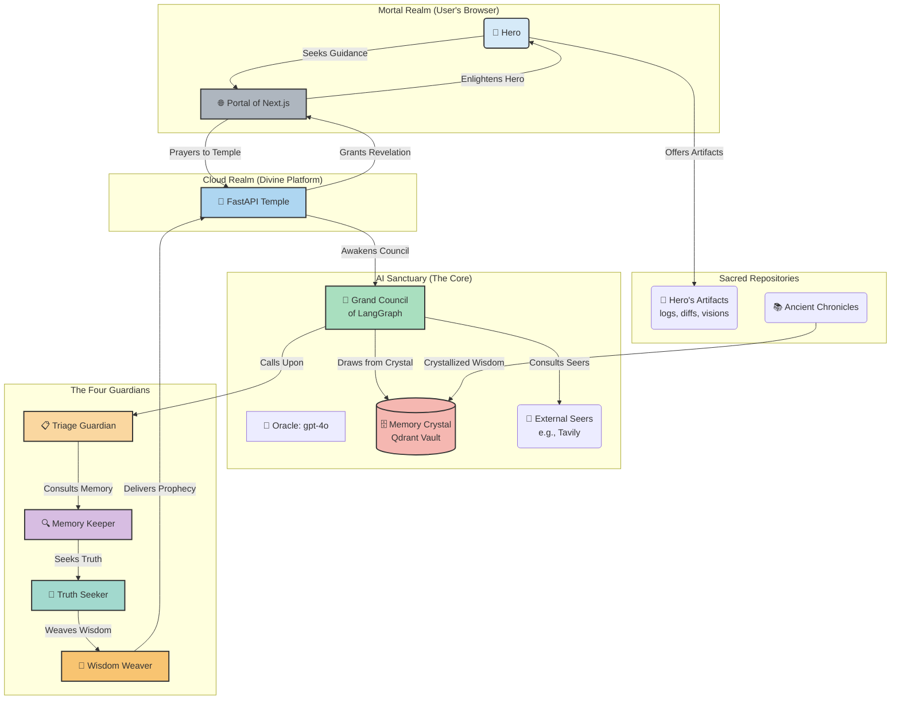

# 🔍 Oncall Lens: AI-Powered Incident Analysis
## Full Product Pitch Presentation - "Full Hero's Journey" Version (10-15 minutes)

---

## Slide 1: Title Slide
**🔍 ONCALL LENS**
*AI-Powered Incident Analysis System*

**Transforming Production Incidents from Hours to Minutes**

*Presented by: [Your Name]*
*Date: [Date]*

---

## Slide 2: The Hero's Call to Adventure 🚨

### **Meet Our Hero: The On-Call Engineer**
*"3 AM. Production is down. Your phone is buzzing. The adventure begins..."*

*🔥 This is fine meme* ← *Everything is on fire, but you're calmly sipping coffee*

**The Hero's Challenge:**
- 🔥 **The Dragon**: Information scattered across 42 systems *(42 tabs open)*
- ⏱️ **The Quest**: Piece together logs, traces, diffs by hand *(Solving a jigsaw puzzle in the dark)*
- 📈 **The Curse**: MTTR rising with system complexity *(MTTR = "More Time To Rage")*
- 😰 **The Toll**: Hero burnout, errors, knowledge silos *(PagerDuty = Sleep Destroyer 3000)*

**The Stakes:**
> Every minute of downtime = **$5,600** in revenue loss
> 
> *"It's not a bug, it's an expensive feature!"* 💸
> 
> **Our heroes needed a guide...**

*Speaker Note: Frame engineers as heroes on a quest - everyone relates to being the hero of their own story*

---

## Slide 3: The Mentor Appears 🧙‍♂️

### **Meet Oncall Lens: The Hero's AI Guide**

**🎯 The Mentor's Gift:**
*"I will transform your chaos into clarity, young hero..."*

**✨ The Magic Powers:**
- 🤖 **4 AI Guardians** - Specialized agents working as your team
- 📁 **Multi-Modal Vision** - Sees logs, traces, diffs, screenshots
- 🧠 **Ancient Knowledge** - 6 retrieval strategies + historical wisdom
- ⚡ **Time Magic** - Minutes instead of hours

**🔄 The Hero's New Journey:**
1. **Summon** the mentor (upload artifacts)
2. **AI Guardians** analyze and correlate
3. **Ancient Wisdom** from past battles
4. **Oracle's Guidance** with confidence scores

*"No longer shall heroes wander in darkness - the path is illuminated"*

---

## Slide 4: The Hero's Transformation ⚡

### **From Zero to Hero** *(The abyss conquered, the hero emerges transformed)*

**The Death & Rebirth:**
| The Old Way (Abyss) | The New Way (Rebirth) | Transformation |
|---------------------|----------------------|----------------|
| **16.3% Accuracy** | **100% Accuracy** | **🚀 +513% Power** |
| **75% Precision** | **100% Precision** | **📈 +33% Focus** |
| **83% Recall** | **100% Recall** | **⚡ +20% Memory** |
| **26.7% Faith** | **100% Faith** | **🎯 +275% Trust** |

### **The Hero's New Powers:**
- ⚡ **Time Control** - Minutes instead of hours *(Sleep schedule restored)*
- 🎯 **Perfect Vision** - 100% across all metrics *(Oracle-level insight)*
- 🧠 **Wisdom Amplified** - 513% improvement *(Math doesn't lie, unlike that "quick hotfix")*

**The hero has crossed the threshold and returned with supernatural aid...**

*Speaker Note: This is the transformation moment - the hero gains new powers*

---

## Slide 5: The Fellowship of Heroes 👥

### **Who Joins This Quest?**

**🎯 The Core Fellowship:**
- **On-call Knights**: Front-line defenders of production
- **SRE Wizards**: Masters of complex system magic
- **DevOps Rangers**: Guardians of infrastructure realms

**🏢 The Supporting Alliance:**
- **Engineering Lords**: Leaders seeking to protect their people
- **Platform Guardians**: Keepers of system reliability

### **The Shared Quests:**
- 🚨 **Battle Production Dragons** - Real-time incident response
- 📋 **Chronicle Past Victories** - Post-incident wisdom gathering
- 🎓 **Train New Heroes** - Knowledge transfer rituals
- 🔍 **Reveal Hidden Patterns** - Ancient incident archaeology

**50K+ engineering kingdoms worldwide await this power...**

*Speaker Note: Frame the audience as fellow heroes joining the quest*

---

## Slide 6: The Hero's Trial by Fire 🎬
### **Witness the Magic in Battle**

*"Hold my coffee, watch this!" ☕* ← *Hero's confidence before facing the dragon*

**The Great Trial: CPU Spike Dragon**
- Ancient scrolls *(Production logs - the good stuff)*
- Prophecies of doom *(Stack traces - Java's favorite novel)*
- Forbidden knowledge *(Config diffs - someone changed something...)*

**Behold the Hero's New Powers:**
1. 📁 **Summon the Mentor** *(No more grep-ing through 50GB logs)*
2. 🤖 **4 AI Guardians Awaken** *(AI doing the heavy lifting)*
3. ⚡ **Real-time Oracle Vision** *(Like watching Netflix, but for bugs)*
4. 📊 **Divine Revelation** *(AI is more confident than we are)*
5. 🔍 **Ancient Wisdom Unlocked** *("We've seen this dragon before")*

*[THE HERO'S TRIAL: 2-4 minutes]*

**The hero shall demonstrate their newfound power...**

*Speaker Note: This is the hero proving their transformation. Pray to the demo gods! 🙏*

---

## Slide 7: The Sacred Architecture 🏗️

### **The Mystical System Behind the Magic**

*Speaker Note: Walk through the sacred flow - Hero offers artifacts → Guardians awaken → Divine wisdom delivered*

---

## Slide 8: The Six Sacred Arts 🔬

### **Ancient Retrieval Magic Working in Harmony**

1. **🎯 The Naive Path**: Basic seeking arts (for comparison)
2. **📄 Parent Document Mastery**: Small visions, grand revelations
3. **🔤 BM25 Runes**: Ancient keyword incantations
4. **🔄 Multi-Query Divination**: Oracle-spawned question variants
5. **⚖️ Hybrid Harmony**: BM25 runes (30%) + Semantic magic (70%)
6. **🎭 The Grand Ensemble**: All sacred arts united as one

**🏆 Divine Result**: Perfect mastery across all mystical metrics

*Speaker Note: This is the source of our 513% power amplification*

---

## Slide 9: The Great Market Kingdom 💰

### **The Vast Realm Awaiting Liberation**

**📈 Kingdom Size:**
- **DevOps Realm**: $8.2B (2023) → $25.5B (2030)
- **Incident Response Territories**: $4.1B
- **Our Destiny**: 50K+ engineering kingdoms globally

**🎯 The Three Realms:**
- **Small Kingdoms**: 10-50 heroes (Humble beginnings)
- **Growing Empires**: 50-500 heroes (Expansion focused)
- **Great Dynasties**: 500+ heroes (Legacy & reliability)

**💡 Why the Stars Align Now:**
- Cloud complexity spawning new dragons daily
- AI/ML magic adoption accelerating across realms
- Remote quests making incident response more perilous

*Speaker Note: Conservative prophecies - the true realm could be far vaster*

---

## Slide 10: The Three-Phase Conquest 🎯

### **Our Strategic Campaign**

**🚀 Phase 1: The Freemium Awakening (Moons 1-6)**
- Target: Small hero bands (0-50 warriors)
- Free trials: 10 quests/moon
- Hero tier: $29/warrior/moon
- Channels: Product Hunt rallies, hero gatherings

**🏢 Phase 2: The Enterprise Crusade (Moons 6-18)**
- Target: Great kingdoms (500+ heroes)
- Royal contracts: $50K-500K annually
- Channels: Direct emissaries, alliance partnerships

**🤝 Phase 3: The White-label Alliance (Moons 12+)**
- Target: Monitoring guilds (Datadog, New Relic)
- Tribute sharing: 30-50%
- Channels: Sacred partnerships

*Speaker Note: Conservative war plans show $10M tribute by Year 2*

---

## Slide 11: The Infinite Scaling Prophecy 📈

### **Built for Eternal Growth**

**🏗️ The Sacred Architecture:**
- **Multi-realm design**: Each kingdom isolated and protected
- **Infinite expansion**: Auto-scaling as dragons multiply
- **Edge fortresses**: Regional strongholds for <100ms response

**💰 The Economic Harmony:**
- **Quest-based tribute**: Pay per dragon vanquished
- **Elastic resources**: Scale up when dragon swarms appear
- **Efficient vaults**: Compressed memory crystals + archiving

**🔒 Enterprise Sanctuaries:**
- **Isolated fortresses**: Air-gapped sacred grounds
- **Private realms**: Dedicated cloud kingdoms
- **Hybrid domains**: Mix of cloud and fortress deployment

*Speaker Note: Can handle 10K+ simultaneous dragon battles with current magic*

---

## Slide 12: Why We Shall Triumph 🏆

### **Our Legendary Advantages**

**🤖 The Four Guardian System**
- Not mere search - true reasoning and synthesis magic
- 4 specialized guardians vs. single-minded rivals

**📊 Proven Divine Power**
- 513% power amplification (Oracle-verified)
- Perfect mastery across all sacred metrics

**🔧 Multi-Modal Vision**
- Sees logs, traces, diffs, mystical screenshots
- Rivals handle only ancient text scrolls

**⚡ Time Mastery**
- Minutes vs. hours for dragon defeat
- Real-time progress divination

**🧠 Ever-Learning Wisdom**
- Builds crystal memory from every battle
- Grows wiser with each quest

*Speaker Note: This isn't mere improvement - it's a paradigm revolution*

---

## Slide 13: The Future Prophecy 🛣️

### **What Legends Await**

**📅 Next 6 Moons:**
- 🎨 Advanced vision magic (GPT-4 Oracle Eyes)
- 👥 Fellowship collaboration rituals
- 📱 Portable scrying devices for mobile quests

**📅 Next 12 Moons:**
- 🕸️ Graph magic for service dependencies
- 🔄 Real-time monitoring integration
- 🎯 Fine-tuned domain-specific enchantments

**📅 The Ultimate Vision:**
- 🤖 Prophetic incident prevention
- 🌐 Realm-specific magical solutions
- 🧠 Autonomous dragon vanquishing

*Speaker Note: We're not just solving today's dragons - we're forging tomorrow's legendary weapons*

---

## Slide 14: The Hero's Triumphant Return 🚀

### **Bringing the Sacred Elixir to All Realms**

**🎯 For the Wise Council (Noble Investors):**
- Vast kingdoms to liberate ($25.5B by 2030)
- Proven divine magic (513% power amplification)
- Clear path to legendary immortality ($100M+ eternal tribute)

**🏢 For Fellow Heroes (Brave Customers):**
- Begin your legendary quest today (Sacred trial)
- Gain 80%+ speed enchantments
- Transform from mortal to legend

**👥 For Aspiring Legends (Future Heroes):**
- Join our sacred fellowship
- Master cutting-edge AI sorcery
- Shape the destiny of all engineering realms

### **The Final Call to Adventure:**
📧 [your-email@oncalllens.com]
🌐 [www.oncalllens.com]
📱 [LinkedIn/Twitter]

**Every legend begins with a hero's first step into the unknown...**

---

## Slide 15: The Council of Questions 🤔

### **Let the Grand Discussion Begin**

**🎬 Extended Trials Available:**
- Complex multi-dragon encounters
- Historical pattern divination
- Custom knowledge crystal setup

**💬 Sacred Discussion Topics:**
- Technical architecture mysteries revealed
- Integration with existing magical tools
- Custom enterprise fortress deployment
- Alliance partnership opportunities

**📊 Additional Divine Metrics:**
- Detailed RAGAS oracle evaluations
- Performance battle chronicles
- Hero testimonial scrolls

---

## Appendix: The Sacred Technical Codex 🔧

### **For the Technical Mystics**

**🏗️ Architecture Mysteries:**
- LangGraph state machine for guardian coordination
- Qdrant memory crystal with HNSW enchantments
- OpenAI GPT-4o with divine function calling
- FastAPI with async/await performance magic

**📊 Evaluation Sacred Rites:**
- RAGAS metrics: Faithfulness, Relevancy, Precision, Recall
- Synthetic dataset generation from ancient postmortems
- A/B testing framework for retrieval sorcery

**🔒 Security & Sacred Vows:**
- SOC 2 Type II divine compliance
- GDPR/CCPA data protection rituals
- End-to-end encryption shields
- Audit logging chronicles

---

## Speaker Notes & Sacred Timing ⏰

### **The Legendary Performance (Total: 12-15 minutes)**
- **The Call (Slide 2)**: 1-2 minutes
- **The Mentor (Slide 3)**: 1 minute
- **Transformation (Slide 4)**: 1 minute  
- **Fellowship (Slide 5)**: 1-2 minutes
- **Trial by Fire (Slide 6)**: 2-4 minutes
- **Sacred Arts (Slides 7-8)**: 1-2 minutes
- **Kingdom Business (Slides 9-11)**: 2-3 minutes
- **Triumphant Return (Slides 12-14)**: 1-2 minutes
- **The Council**: 3-5 minutes

### **Legendary Talking Points:**
1. **Begin with the call** - the 3 AM dragon every hero knows
2. **Lead with transformation** - 513% power increase is legendary
3. **Show the magic** - the demo is your greatest spell
4. **Reveal the kingdom** - $25.5B realm by 2030
5. **End with destiny** - every hero must choose their path

### **Trial Preparation:**
- Have sacred artifact files ready
- Test the magic beforehand
- Prepare backup vision scrolls
- Practice the 3-4 minute ritual
- Have extended trials ready for the council

---

*Generated for Oncall Lens Product Pitch - "Full Hero's Journey" Version - Confidential*
