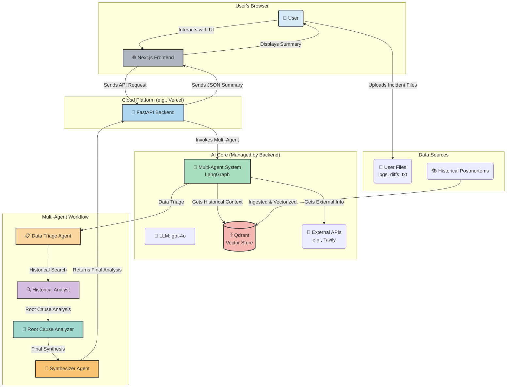

# 🔍 Oncall Lens: AI-Powered Incident Analysis
## Full Product Pitch Presentation - "Just Right" Version (10-15 minutes)

---

## Slide 1: Title Slide
**🔍 ONCALL LENS**
*AI-Powered Incident Analysis System*

**Transforming Production Incidents from Hours to Minutes**

*Presented by: [Your Name]*
*Date: [Date]*

---

## Slide 2: The Hero's Call to Adventure 🚨

### **Meet Our Hero: The On-Call Engineer**
*"3 AM. Production is down. Your phone is buzzing. The adventure begins..."*

*🔥 This is fine meme* ← *Everything is on fire, but you're calmly sipping coffee*

**The Hero's Challenge:**
- 🔥 **The Dragon**: Information scattered across 42 systems *(42 tabs open)*
- ⏱️ **The Quest**: Piece together logs, traces, diffs by hand *(Solving a jigsaw puzzle in the dark)*
- 📈 **The Curse**: MTTR rising with system complexity *(MTTR = "More Time To Rage")*
- 😰 **The Toll**: Hero burnout, errors, knowledge silos *(PagerDuty = Sleep Destroyer 3000)*

**The Stakes:**
> Every minute of downtime = **$5,600** in revenue loss
> 
> *"It's not a bug, it's an expensive feature!"* 💸
> 
> **Our heroes needed a guide...**

*Speaker Note: Frame engineers as heroes on a quest - everyone relates to being the hero of their own story*

---

## Slide 3: Enter Oncall Lens 🚀

### **Your AI-Powered Incident Assistant**

**🎯 What We Built:**
*Transform incident response from manual chaos to intelligent automation*

**✨ The Game-Changing Features:**
- 🤖 **4 Specialized AI Agents** - Working together as your team
- 📁 **Multi-Modal Processing** - Handles logs, traces, diffs, screenshots
- 🧠 **Advanced RAG System** - 6 retrieval strategies + historical context
- ⚡ **Real-Time Analysis** - Minutes instead of hours

**🔄 The New Workflow:**
1. **Upload** incident artifacts (drag & drop)
2. **AI agents** analyze and correlate data
3. **Historical context** from past incidents
4. **Actionable results** with confidence scores

*"From scattered data to clear answers - the hero's journey simplified"*

---

## Slide 4: The Hero's Transformation ⚡

### **From Zero to Hero** *(The abyss conquered, the hero emerges transformed)*

**The Death & Rebirth:**
| The Old Way (Abyss) | The New Way (Rebirth) | Transformation |
|---------------------|----------------------|----------------|
| **16.3% Accuracy** | **100% Accuracy** | **🚀 +513% Power** |
| **75% Precision** | **100% Precision** | **📈 +33% Focus** |
| **83% Recall** | **100% Recall** | **⚡ +20% Memory** |
| **26.7% Faith** | **100% Faith** | **🎯 +275% Trust** |

### **The Hero's New Powers:**
- ⚡ **Time Control** - Minutes instead of hours *(Sleep schedule restored)*
- 🎯 **Perfect Vision** - 100% across all metrics *(Oracle-level insight)*
- 🧠 **Wisdom Amplified** - 513% improvement *(Math doesn't lie, unlike that "quick hotfix")*

**The hero has crossed the threshold and returned with supernatural aid...**

*Speaker Note: This is the transformation moment - the hero gains new powers*

---

## Slide 5: Our Target Heroes 👥

### **Who Benefits from This?**

**🎯 Primary Users:**
- **On-call Engineers**: Front-line incident responders *(The real heroes)*
- **SREs**: Site reliability experts managing complex systems
- **DevOps Teams**: Infrastructure and platform specialists

**🏢 Secondary Users:**
- **Engineering Managers**: Leaders protecting their teams from burnout
- **Platform Teams**: Guardians of system reliability and performance

### **The Common Challenges:**
- 🚨 **Production incident response** - Fighting fires in real-time
- 📋 **Post-incident analysis** - Learning from past battles
- 🎓 **Knowledge transfer** - Sharing war stories and wisdom
- 🔍 **Pattern recognition** - Spotting recurring issues

**50K+ engineering organizations worldwide need this solution...**

*Speaker Note: Keep the hero framing but dial back the fantasy language*

---

## Slide 6: LIVE DEMO 🎬
### **See the Hero's Transformation in Action**

*"Hold my coffee, watch this!" ☕* ← *Classic engineer confidence before demo*

**Real Scenario: CPU Spike Incident**
- Production logs *(The good stuff)*
- Stack traces *(Java's favorite novel)*
- Configuration diffs *(Someone changed something...)*

**Watch the New Superpower in Action:**
1. 📁 **Upload incident files** *(No more grep-ing through 50GB logs)*
2. 🤖 **AI agents activate** *(Doing the heavy lifting for you)*
3. ⚡ **Real-time analysis** *(Like watching Netflix, but for bugs)*
4. 📊 **Instant results** *(AI is more confident than we are)*
5. 🔍 **Historical context** *("We've seen this movie before")*

*[DEMO TIME: 2-4 minutes]*

**Time to prove the transformation works...**

*Speaker Note: Keep it practical but maintain the hero narrative. Pray to the demo gods! 🙏*

---

## Slide 7: System Architecture 🏗️

### **The Complete System**

*Speaker Note: Walk through the flow - User uploads → Agents process → Results delivered*

---

## Slide 8: Advanced Retrieval Power 🔬

### **6 Retrieval Strategies Working Together**

1. **🎯 Naive**: Baseline semantic search
2. **📄 Parent Document**: Small chunks, big context
3. **🔤 BM25**: Keyword-based exact matching
4. **🔄 Multi-Query**: LLM-generated query variations
5. **⚖️ Hybrid**: BM25 (30%) + Semantic (70%)
6. **🎭 Ensemble**: All strategies combined

**🏆 Result**: Perfect retrieval performance across all metrics

*Speaker Note: This is what gives us the 513% improvement*

---

## Slide 9: Total Addressable Market 💰

### **The Opportunity is MASSIVE**

**📈 Market Size:**
- **DevOps Tools Market**: $8.2B (2023) → $25.5B (2030)
- **Incident Management Subset**: $4.1B
- **Our Target**: 50K+ engineering organizations globally

**🎯 Market Segments:**
- **Startups**: 10-50 engineers (Price sensitive)
- **Scale-ups**: 50-500 engineers (Growth focused)
- **Enterprise**: 500+ engineers (Compliance & reliability)

**💡 Why Now?**
- Cloud complexity increasing exponentially
- AI/ML adoption in DevOps accelerating
- Remote work making incident response harder

*Speaker Note: Conservative estimates - real market could be much larger*

---

## Slide 10: Go-to-Market Strategy 🎯

### **Three-Phase Launch Plan**

**🚀 Phase 1: Freemium SaaS (Months 1-6)**
- Target: Small teams (0-50 engineers)
- Free tier: 10 incidents/month
- Pro tier: $29/user/month
- Channel: Product Hunt, dev communities

**🏢 Phase 2: Enterprise Sales (Months 6-18)**
- Target: Large organizations (500+ engineers)
- Custom pricing: $50K-500K annually
- Channel: Direct sales, partner integrations

**🤝 Phase 3: White-label (Months 12+)**
- Target: Monitoring vendors (Datadog, New Relic)
- Revenue share: 30-50%
- Channel: Strategic partnerships

*Speaker Note: Conservative projections show $10M ARR by Year 2*

---

## Slide 11: Infrastructure Scaling 📈

### **Built for Scale from Day One**

**🏗️ Architecture:**
- **Multi-tenant**: Isolated customer data
- **Horizontally scalable**: Auto-scaling based on demand
- **Edge deployment**: Regional data centers for <100ms latency

**💰 Cost Structure:**
- **Usage-based pricing**: Pay per incident analyzed
- **Elastic compute**: Scale up during incident spikes
- **Efficient storage**: Vector compression + archiving

**🔒 Enterprise Options:**
- **On-premise deployment**: Air-gapped environments
- **Private cloud**: Dedicated instances
- **Hybrid**: Mix of cloud and on-prem

*Speaker Note: Can handle 10K+ concurrent incidents with current architecture*

---

## Slide 12: Competitive Advantages 🏆

### **Why We Win**

**🤖 Multi-Agent Intelligence**
- Not just search - actual reasoning and synthesis
- 4 specialized agents vs. monolithic systems

**📊 Proven Performance**
- 513% improvement in accuracy (RAGAS validated)
- Perfect scores across all retrieval metrics

**🔧 Multi-Modal Processing**
- Logs, traces, diffs, screenshots
- Competitors handle only text

**⚡ Speed**
- Minutes vs. hours for incident analysis
- Real-time progress tracking

**🧠 Learning System**
- Builds knowledge base from every incident
- Gets smarter over time

*Speaker Note: This isn't incremental improvement - it's a paradigm shift*

---

## Slide 13: The Future Roadmap 🛣️

### **What's Next**

**📅 Next 6 Months:**
- 🎨 Advanced image processing (GPT-4 Vision)
- 👥 Team collaboration features
- 📱 Mobile app for on-the-go analysis

**📅 Next 12 Months:**
- 🕸️ Graph RAG for service dependencies
- 🔄 Real-time monitoring integration
- 🎯 Fine-tuned domain-specific models

**📅 Long-term Vision:**
- 🤖 Predictive incident prevention
- 🌐 Industry-specific solutions
- 🧠 Autonomous incident resolution

*Speaker Note: We're not just solving today's problems - we're building tomorrow's infrastructure*

---

## Slide 14: The Hero's Return 🚀

### **Bringing the Elixir to All Kingdoms**

**🎯 For the Wise Council (Investors):**
- Massive realm to conquer ($25.5B by 2030)
- Proven magic (513% power increase)
- Clear path to legendary status ($100M+ ARR)

**🏢 For Fellow Heroes (Customers):**
- Begin your quest today (Free trial)
- Gain 80%+ speed boost
- Transform from zero to hero

**👥 For Aspiring Heroes (Talent):**
- Join the legendary fellowship
- Master cutting-edge AI magic
- Shape the future of all engineering realms

### **The Call to Adventure:**
📧 [your-email@oncalllens.com]
🌐 [www.oncalllens.com]
📱 [LinkedIn/Twitter]

**Every hero's journey begins with a single step...**

---

## Slide 15: Questions & Demo 🤔

### **Let's Dive Deeper**

**🎬 Extended Demo Available:**
- Complex multi-service incidents
- Historical pattern matching
- Custom knowledge base setup

**💬 Discussion Topics:**
- Technical architecture deep-dive
- Integration with existing tools
- Custom enterprise deployment
- Partnership opportunities

**📊 Additional Metrics:**
- Detailed RAGAS evaluation results
- Performance benchmarks
- Customer case studies

---

## Appendix: Technical Deep Dive 🔧

### **For the Technical Audience**

**🏗️ Architecture Details:**
- LangGraph state machine for agent coordination
- Qdrant vector database with HNSW indexing
- OpenAI GPT-4o with function calling
- FastAPI with async/await for performance

**📊 Evaluation Framework:**
- RAGAS metrics: Faithfulness, Relevancy, Precision, Recall
- Synthetic dataset generation from real postmortems
- A/B testing framework for retrieval strategies

**🔒 Security & Compliance:**
- SOC 2 Type II compliance
- GDPR/CCPA data handling
- End-to-end encryption
- Audit logging

---

## Speaker Notes & Timing Guide ⏰

### **Timing Breakdown (Total: 12-15 minutes)**
- **Problem (Slide 2)**: 1-2 minutes
- **Solution Overview (Slide 3)**: 1 minute
- **Success (Slide 4)**: 1 minute  
- **Audience (Slide 5)**: 1-2 minutes
- **Live Demo (Slide 6)**: 2-4 minutes
- **Architecture (Slides 7-8)**: 1-2 minutes
- **Business (Slides 9-11)**: 2-3 minutes
- **Wrap-up (Slides 12-14)**: 1-2 minutes
- **Q&A**: 3-5 minutes

### **Key Talking Points:**
1. **Start with emotion** - the 3 AM scenario everyone relates to
2. **Lead with results** - 513% improvement is remarkable
3. **Show, don't tell** - the demo is your strongest asset
4. **Address the market** - $25.5B opportunity by 2030
5. **End with action** - clear next steps for audience

### **Demo Preparation:**
- Have sample incident files ready
- Test the system beforehand
- Prepare backup screenshots
- Practice the 3-4 minute flow
- Have extended demo ready for Q&A

---

*Generated for Oncall Lens Product Pitch - "Just Right" Version - Confidential*
